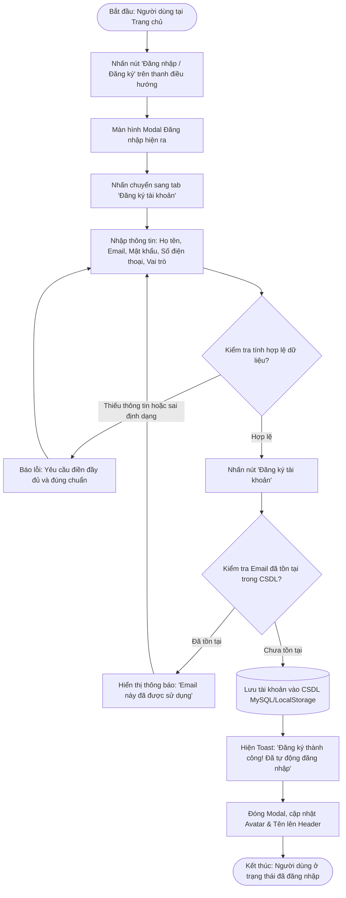
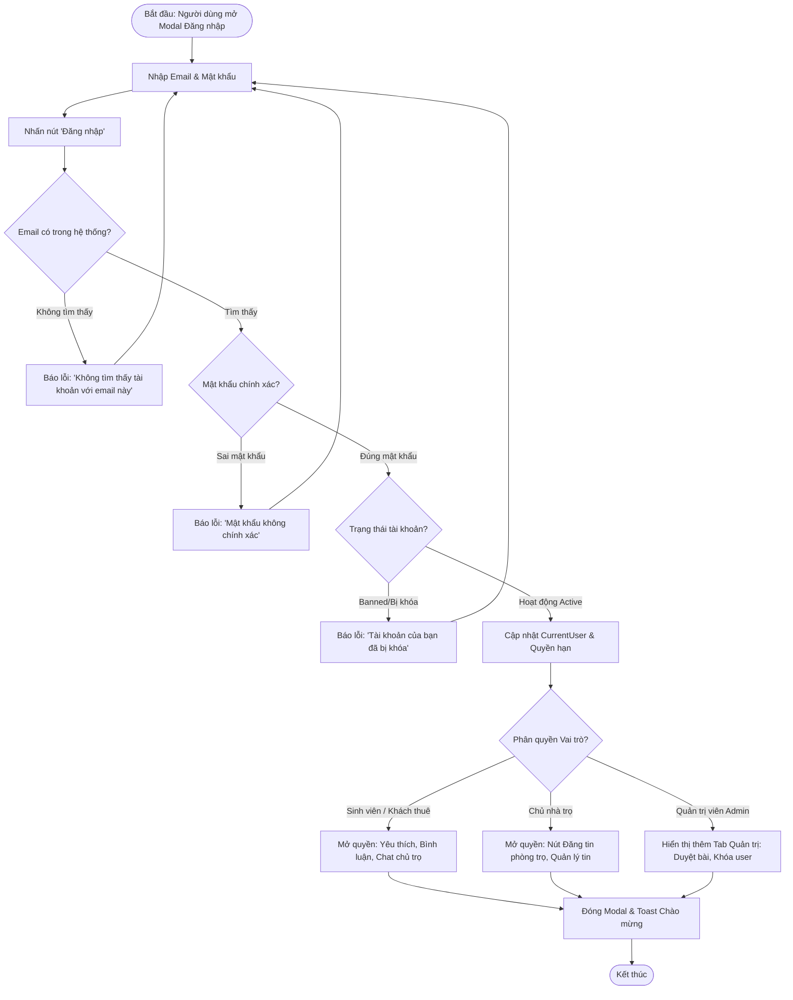
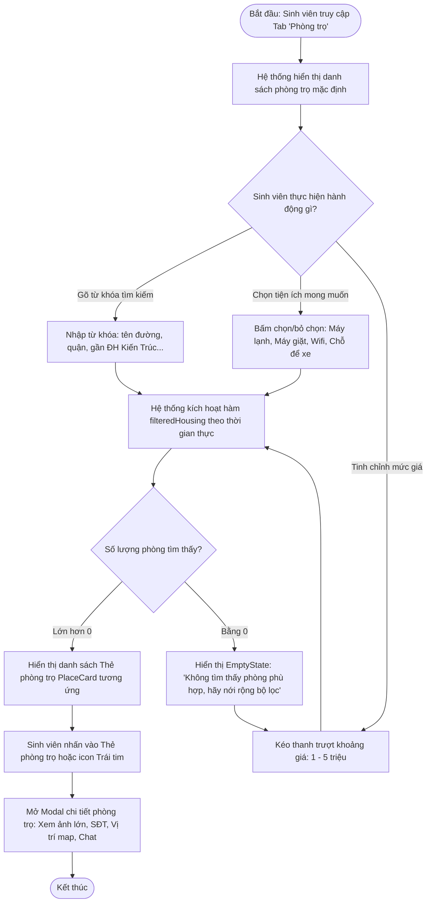
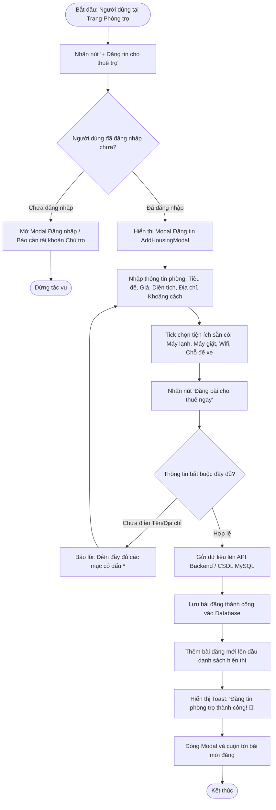

# 📱 BÁO CÁO THIẾT KẾ PHẦN MỀM: THIẾT KẾ UI/UX HỆ THỐNG UNILIFE
**Học phần:** Công nghệ phần mềm / Thiết kế phần mềm  
**Đề tài:** UniLife — Nền tảng hỗ trợ đời sống sinh viên (All-in-One Platform)  
**Sinh viên thực hiện:** Phan Trí Đức (Lớp 24CT1)  

---

## 📌 NỘI DUNG YÊU CẦU BÀI TẬP (THEO BÀI GIẢNG 4.1)
Quy trình thiết kế UI/UX chuẩn cho mỗi chức năng trong hệ thống phần mềm gồm **3 bước**:
1. **Bước 1. User Flow (Luồng người dùng):** Mô tả chi tiết từng bước mà người dùng thực hiện để hoàn thành tác vụ trong hệ thống (kèm sơ đồ luồng luân chuyển trạng thái).
2. **Bước 2. Wireframe (Bản phác thảo bố cục):** Xác định vị trí các thành phần trên giao diện màn hình (Header, Search Bar, Navigation, Filter Chips, Form Input, Action Buttons, Cards, Modals). Tập trung vào cấu trúc và trải nghiệm người dùng (UX), chưa chú trọng màu sắc phức tạp.
3. **Bước 3. Mockup (Bản thiết kế giao diện chi tiết):** Bổ sung màu sắc, kiểu chữ (Typography), hình ảnh, biểu tượng (Icons), độ bo góc, bóng đổ và phong cách giao diện thành phẩm theo đúng Design System của dự án.

Dưới đây là thiết kế UI/UX hoàn chỉnh cho **4 chức năng cốt lõi** (kèm chức năng mở rộng) của web UniLife.

---

## 🎨 HỆ THỐNG THIẾT KẾ CHUẨN CỦA UNILIFE (DESIGN SYSTEM)
Giao diện UniLife được xây dựng trên bảng màu thân thiện, trẻ trung dành cho sinh viên:
- **Primary Color (Coral):** `#FF5D3E` — Nút hành động chính (CTA), điểm nhấn giá cả, trạng thái nổi bật.
- **Secondary Color (Marigold):** `#FFC145` — Điểm nhấn icon phòng trọ, huy hiệu (Badge) đánh giá.
- **Accent Color (Teal):** `#0E7C66` — Tag danh mục tiện ích, chợ đồ cũ, trạng thái an toàn.
- **Background (Paper):** `#F6F4EE` — Nền trang dịu mắt, phong cách giấy hiện đại.
- **Card Background:** `#FFFFFF` — Nền thẻ card nội dung với bo góc `border-radius: 14px` và viền nhẹ `#ECE7D8`.
- **Text Color (Ink):** `#16192E` — Chữ tiêu đề và nội dung chính, độ tương phản cao.
- **Subtext Color:** `#6B6A63` — Mô tả phụ, chú thích, thông số kỹ thuật.
- **Font chữ:** `Segoe UI`, `Inter`, `system-ui`, sans-serif.

---

# CHỨC NĂNG 1: ĐĂNG KÝ TÀI KHOẢN MỚI (USER REGISTRATION)

### 1.1. Bước 1: User Flow (Luồng người dùng)
Luồng mô tả các thao tác của người dùng từ khi mở website đến khi hoàn tất tạo tài khoản với vai trò phù hợp (Sinh viên / Chủ trọ / Quản trị viên).



#### Bảng kịch bản các bước:
| Bước | Người dùng thao tác | Hệ thống phản hồi |
| :--- | :--- | :--- |
| 1 | Nhấn nút "Tài khoản" trên Top Bar | Hiển thị Modal `AuthModal` ở chế độ mặc định |
| 2 | Chọn tab "Đăng ký" | Hiển thị form gồm các ô: Họ tên, Email, Mật khẩu, SĐT, Chọn vai trò |
| 3 | Nhập thông tin cá nhân và chọn vai trò (Khách hàng / Chủ nhà trọ) | Kiểm tra định dạng trường dữ liệu thời gian thực (Client-side validation) |
| 4 | Nhấn nút "Đăng ký tài khoản" | Gửi request đến backend/service kiểm tra trùng lặp email |
| 5 | Nhận phản hồi thành công | Tự động gán Avatar ngẫu nhiên, lưu phiên đăng nhập, hiển thị thông báo Toast xanh |

---

### 1.2. Bước 2: Wireframe (Bản phác thảo bố cục - Layout Structure)
Bản phác thảo cấu trúc thành phần của cửa sổ Modal Đăng ký:

```
+-----------------------------------------------------------------+
| [X] Overlay Background mờ (Backdrop: rgba(0,0,0,0.65))          |
|                                                                 |
|   +---------------------------------------------------------+   |
|   |  [Logo UniLife]  ĐĂNG KÝ TÀI KHOẢN              [ Đóng X] |   |
|   |  Gia nhập cộng đồng sinh viên năng động ngay hôm nay    |   |
|   +---------------------------------------------------------+   |
|   |  [ Tab Đăng Nhập ]      |  [[ Tab Đăng Ký (Active) ]]   |   |
|   +---------------------------------------------------------+   |
|   |                                                         |   |
|   |  Họ và tên sinh viên / chủ trọ: (*)                     |   |
|   |  [ [icon-user]  Nguyễn Văn A                          ] |   |
|   |                                                         |   |
|   |  Địa chỉ Email sinh viên: (*)                           |   |
|   |  [ [icon-mail]  sinhvien@truong.edu.vn                ] |   |
|   |                                                         |   |
|   |  Mật khẩu bảo mật: (*)                                  |   |
|   |  [ [icon-lock]  ••••••••••••••                [eye]   ] |   |
|   |                                                         |   |
|   |  Số điện thoại liên hệ:                                 |   |
|   |  [ [icon-phone] 0908.xxx.xxx                          ] |   |
|   |                                                         |   |
|   |  Bạn tham gia với vai trò gì? (*)                       |   |
|   |  (o) Sinh viên / Khách thuê     ( ) Chủ nhà trọ         |   |
|   |                                                         |   |
|   |  [ ! ] Thông báo lỗi (nếu email đã tồn tại / để trống)  |   |
|   |                                                         |   |
|   |  +---------------------------------------------------+  |   |
|   |  | [BUTTON ĐĂNG KÝ TÀI KHOẢN - FULL WIDTH]           |  |   |
|   |  +---------------------------------------------------+  |   |
|   |                                                         |   |
|   |  Đã có tài khoản? [Đăng nhập ngay]                      |   |
|   +---------------------------------------------------------+   |
+-----------------------------------------------------------------+
```

---

### 1.3. Bước 3: Mockup (Bản thiết kế giao diện chi tiết)
Thiết kế chi tiết thành phẩm được cấu thành trong mã nguồn [`AuthModal.jsx`](file:///d:/24CT1-PHANTRIDUC/src/components/modals/AuthModal.jsx):
- **Cửa sổ Modal:** Khối Card bo tròn 18px (`borderRadius: 18`), nền trắng tinh khiết `#FFFFFF`, đổ bóng sâu `boxShadow: 0 24px 60px rgba(0,0,0,0.3)`.
- **Thanh chuyển Tab:** Phân cách 2 nút "Đăng nhập" và "Tạo tài khoản mới" với hiệu ứng active nền cam Coral `#FF5D3E`, chữ trắng đậm.
- **Trường nhập liệu (Input Fields):** Viền xám mỏng `#E0DCD0`, có icon minh họa bên trái (`lucide-react`: `User`, `Mail`, `Lock`, `Phone`), padding 12px 14px, focus viền sáng chuyển sang màu Coral.
- **Nút hành động chính (Submit Button):** Nền Coral rực rỡ `#FF5D3E`, chữ trắng, bo tròn 10px, hiệu ứng khi hover sáng màu và khi submit hiển thị icon `Loader2` xoay vòng thân thiện.
- **Hệ thống phản hồi:** Thông báo lỗi bọc trong khung màu đỏ nhạt nền `#FEE2E2` kèm icon `AlertCircle`; thông báo thành công hiển thị Toast góc màn hình.

---

# CHỨC NĂNG 2: ĐĂNG NHẬP HỆ THỐNG & PHÂN QUYỀN (USER LOGIN & RBAC)

### 2.1. Bước 1: User Flow (Luồng người dùng)
Mô tả quy trình người dùng nhập thông tin đăng nhập, xác thực mật khẩu, kiểm tra trạng thái khóa tài khoản và điều hướng theo vai trò (Sinh viên, Chủ trọ, Quản trị viên).



---

### 2.2. Bước 2: Wireframe (Bản phác thảo bố cục - Layout Structure)
Bố cục giao diện màn hình Đăng nhập và thanh Header sau khi đăng nhập:

```
BỐ CỤC FORM ĐĂNG NHẬP (MODAL):
+-----------------------------------------------------------------+
|   +---------------------------------------------------------+   |
|   |  ĐĂNG NHẬP UNILIFE                              [ Đóng X] |   |
|   |  Truy cập để lưu phòng yêu thích và liên hệ chủ nhà     |   |
|   +---------------------------------------------------------+   |
|   |  [[ Tab Đăng Nhập (Active) ]]    |   [ Tab Đăng Ký ]    |   |
|   +---------------------------------------------------------+   |
|   |                                                         |   |
|   |  Email tài khoản:                                       |   |
|   |  [ [icon-mail]  admin@unilife.vn hoặc sinhvien@...    ] |   |
|   |                                                         |   |
|   |  Mật khẩu:                                              |   |
|   |  [ [icon-lock]  ••••••••••••••••••••          [eye]   ] |   |
|   |                                                         |   |
|   |  [ ] Ghi nhớ đăng nhập                 [Quên mật khẩu?] |   |
|   |                                                         |   |
|   |  +---------------------------------------------------+  |   |
|   |  | [BUTTON ĐĂNG NHẬP NGAY - MÀU CORAL]               |  |   |
|   |  +---------------------------------------------------+  |   |
|   |                                                         |   |
|   |  Gợi ý tài khoản demo: Admin (admin@unilife.vn)         |   |
|   +---------------------------------------------------------+   |
+-----------------------------------------------------------------+

BỐ CỤC THANH ĐIỀU HƯỚNG HEADER SAU KHI ĐĂNG NHẬP THÀNH CÔNG:
+-----------------------------------------------------------------+
| [Logo UniLife]  [Trang chủ] [Phòng trọ] [Ăn uống] [Chợ đồ cũ]   |
|                                                                 |
|   (Bên phải): [Nút + Đăng tin]  [Yêu thích (3)]  [Avatar User]  |
|                                                  [Tên + Quyền]  |
+-----------------------------------------------------------------+
```

---

### 2.3. Bước 3: Mockup (Bản thiết kế giao diện chi tiết)
- **Tiêu đề & Brand:** Logo UniLife phối 3 màu (Marigold, Coral, Teal), dòng phụ xám `#6B6A63` mang lại cảm giác chỉn chu.
- **Form đăng nhập:** Thiết kế trực quan với khoảng cách giữa các input là `gap: 14px`, nhãn input in đậm `fontWeight: 600`, ô nhập có viền sáng bóng.
- **Khối tài khoản mẫu (Quick Login Hint):** Thiết kế hộp xám nhạt bo góc 8px liệt kê sẵn tài khoản test cho Giảng viên trải nghiệm nhanh (Admin, Chủ trọ, Sinh viên).
- **Header cập nhật sau đăng nhập:** Avatar bo tròn hiển thị ảnh chân dung sinh viên, bên cạnh có Badge vai trò (màu Teal cho Chủ trọ, Coral cho Admin), kèm nút Đăng xuất tinh tế.

---

# CHỨC NĂNG 3: TÌM KIẾM & BỘ LỌC PHÒNG TRỌ ĐA TIÊU CHÍ (SEARCH & MULTI-CRITERIA FILTERING)

### 3.1. Bước 1: User Flow (Luồng người dùng)
Mô tả quy trình sinh viên tìm kiếm phòng trọ theo từ khóa, tinh chỉnh theo các tiêu chí tiện ích và mức giá trần phù hợp với túi tiền.



---

### 3.2. Bước 2: Wireframe (Bản phác thảo bố cục - Layout Structure)
Bố cục chi tiết màn hình Tìm kiếm và Lọc phòng trọ [`HousingView.jsx`](file:///d:/24CT1-PHANTRIDUC/src/views/HousingView.jsx):

```
+-----------------------------------------------------------------------------------+
|  HEADER TRANG:                                                                    |
|  Tìm phòng trọ sinh viên                             [+ Đăng tin cho thuê trọ]   |
|  Có 12 phòng trọ phù hợp với tiêu chí của bạn                                     |
+-----------------------------------------------------------------------------------+
|  THANH TÌM KIẾM TỪ KHÓA (SEARCH BAR):                                             |
|  [ [icon-search]  Tìm theo tên phòng, đường, quận hoặc khu vực quanh trường... [X] ] |
+-----------------------------------------------------------------------------------+
|  BẢNG BỘ LỌC TIỆN ÍCH & MỨC GIÁ (FILTER BAR):                                     |
|  [icon-filter] Tiện ích:                                                          |
|  [(*) Máy lạnh]  [(*) Máy giặt]  [(*) Wifi miễn phí]  [(*) Chỗ giữ xe]            |
|                                                                                   |
|                                    Mức giá tối đa: [ 3.5 triệu ]                  |
|                                    Min [======O======] Max (5tr)                  |
+-----------------------------------------------------------------------------------+
|  LƯỚI DANH SÁCH THẺ PHÒNG TRỌ (GRID LAYOUT: 3 - 4 CỘT):                           |
|  +------------------------+  +------------------------+  +---------------------+  |
|  | [ Ảnh phòng trọ ] [❤️]  |  | [ Ảnh phòng trọ ] [🤍]  |  | [ Ảnh phòng trọ ][🤍] |  |
|  | [3.2 triệu/tháng]      |  | [2.5 triệu/tháng]      |  | [1.8 triệu/tháng]   |  |
|  | Phòng ban công ĐH Bách |  | Ký túc xá dịch vụ mini |  | Phòng trọ giá rẻ    |  |
|  | [icon-pin] Q. Hải Châu |  | [icon-pin] Q. Thanh Khê|  | [icon-pin] Q. Liên C|  |
|  | ⭐ 4.9 (18 đánh giá)   |  | ⭐ 4.7 (9 đánh giá)    |  | ⭐ 4.5 (12 review)  |  |
|  | [Máy lạnh][Wifi][Xe]   |  | [Máy giặt][Wifi]       |  | [Wifi][Chỗ xe]      |  |
|  +------------------------+  +------------------------+  +---------------------+  |
+-----------------------------------------------------------------------------------+
```

---

### 3.3. Bước 3: Mockup (Bản thiết kế giao diện chi tiết)
- **Thanh tìm kiếm (Search Bar):** Đặt nổi bật ở phía trên với icon `Search` màu `#6B6A63`, ô input màu trắng với hiệu ứng shadow nhẹ, nút xóa nhanh `X` khi có từ khóa.
- **Thanh lọc tiện ích (Filter Chips):** Các nút bấm dạng viên thuốc (Pill Chip) bo tròn 20px:
  - Trạng thái chưa chọn: Nền trắng viền xám `#E0DCD0`, icon và chữ màu xám tối.
  - Trạng thái đã chọn (Active): Nền màu Coral `#FF5D3E`, chữ và icon trắng nổi bật.
- **Thanh trượt giá (Price Range Slider):** Điểm nút kéo trượt mang màu nhấn cam Coral, hiển thị số tiền động bằng chữ đậm to `3.5 triệu`.
- **Thẻ phòng trọ (`PlaceCard.jsx`):**
  - Khung ảnh tỷ lệ 16:9 sắc nét, phủ góc trên bên phải là nút bấm Yêu thích `FavButton` hình trái tim (chuyển sang màu đỏ rực khi yêu thích).
  - Giá thuê in đậm bằng màu Coral `#FF5D3E` cỡ chữ 18px để sinh viên dễ dàng so sánh giá.
  - Dòng tiện ích hiển thị các icon nhỏ xám tinh gọn kèm khoảng cách tới trường đại học (Ví dụ: `Cách trường 350m`).

---

# CHỨC NĂNG 4: ĐĂNG TIN CHO THUÊ PHÒNG TRỌ MỚI (POST RENTAL HOUSING LISTING)

### 4.1. Bước 1: User Flow (Luồng người dùng)
Mô tả quy trình chủ trọ hoặc sinh viên đăng thông tin phòng trọ cần cho thuê lên sàn giao dịch UniLife.



---

### 4.2. Bước 2: Wireframe (Bản phác thảo bố cục - Layout Structure)
Bản phác thảo cấu trúc thành phần Form đăng bài [`AddHousingModal.jsx`](file:///d:/24CT1-PHANTRIDUC/src/components/modals/AddHousingModal.jsx):

```
+-----------------------------------------------------------------+
| [X] Overlay Background mờ (Backdrop: rgba(22,25,46,0.65))       |
|                                                                 |
|   +---------------------------------------------------------+   |
|   |  ĐĂNG TIN PHÒNG TRỌ CHO THUÊ                    [ Đóng X] |   |
|   +---------------------------------------------------------+   |
|   |  Tiêu đề phòng trọ: (*)                                 |   |
|   |  [ Ví dụ: Phòng trọ ban công gần ĐH Kiến Trúc...      ] |   |
|   |                                                         |   |
|   |  +--------------------------+  +---------------------+  |   |
|   |  | Giá thuê (Triệu/tháng):* |  | Diện tích phòng:*   |  |   |
|   |  | [ 2.5                  ] |  | [ 25m²            ] |  |   |
|   |  +--------------------------+  +---------------------+  |   |
|   |                                                         |   |
|   |  Địa chỉ chi tiết phòng trọ: (*)                        |   |
|   |  [ Số 123 đường Núi Thành, Quận Hải Châu, Đà Nẵng     ] |   |
|   |                                                         |   |
|   |  Khoảng cách đến trường đại học:                        |   |
|   |  [ 450m                                               ] |   |
|   |                                                         |   |
|   |  Các tiện ích phòng có sẵn:                             |   |
|   |  [X] Máy lạnh       [X] Máy giặt                        |   |
|   |  [X] Wifi tốc độ cao [X] Chỗ để xe an toàn              |   |
|   |                                                         |   |
|   |  +---------------------------------------------------+  |   |
|   |  | [BUTTON: ĐĂNG BÀI CHO THUÊ NGAY (MÀU CORAL)]      |  |   |
|   |  +---------------------------------------------------+  |   |
|   +---------------------------------------------------------+   |
+-----------------------------------------------------------------+
```

---

### 4.3. Bước 3: Mockup (Bản thiết kế giao diện chi tiết)
- **Cửa sổ nhập liệu:** Modal rộng tối đa 500px, bo tròn mềm mại 16px, background `#FFFFFF`, có animation mở mượt mà (`animate-modal-in`).
- **Phân chia lưới Form 2 cột (Grid System):** Giá thuê và diện tích phòng được chia làm 2 ô đối xứng giúp tiết kiệm không gian màn hình và người dùng nhập liệu nhanh chóng.
- **Hộp chọn tiện ích (Checkboxes / Toggles):** Thiết kế dạng ô bấm trực quan với icon minh họa: quạt máy lạnh, máy giặt, sóng wifi, xe máy. Khi được tick, ô chuyển sang màu viền xanh Teal `#0E7C66`.
- **Nút gửi bài đăng (Submit CTA):** Nền Coral rực rỡ `#FF5D3E`, chữ trắng in hoa đậm, hiệu ứng chuyển màu khi di chuột, khi bấm có icon `Loader2` quay tròn thể hiện trạng thái gửi dữ liệu.

---

# CHỨC NĂNG MỞ RỘNG (BONUS): CHỢ ĐỒ CŨ SINH VIÊN (STUDENT MARKETPLACE)

> *Trường hợp Giảng viên gộp Đăng nhập & Đăng ký thành 1 Module Xác thực chung, chức năng Chợ đồ cũ sinh viên sẽ đảm bảo bạn có đủ 4 nghiệp vụ phần mềm độc lập hoàn chỉnh!*

### 5.1. Bước 1: User Flow (Luồng người dùng)
Luồng sinh viên duyệt mua giáo trình, máy tính cũ hoặc đăng thanh lý đồ dùng học tập:
1. Sinh viên vào tab **Chợ đồ cũ** (`MarketView.jsx`).
2. Chọn danh mục: Tất cả, Sách, Đồ công nghệ, Xe cộ, Dụng cụ học tập.
3. Nhấn vào sản phẩm để xem độ mới (%) và giá sinh viên thanh lý.
4. Bấm "Liên hệ người bán" để gọi điện hoặc mở cửa sổ Chat trực tiếp.

### 5.2. Bước 2: Wireframe (Bản phác thảo bố cục)
- **Top:** Tiêu đề "Chợ sinh viên & Trao đổi đồ cũ" + Nút `+ Đăng bán đồ cũ`.
- **Category Filter:** Hàng nút bấm chọn danh mục dạng ngang (Chips).
- **Product Grid:** Danh sách thẻ `ProductCard` hiển thị: Ảnh đồ cũ, Tag tình trạng (Ví dụ: `Còn 95%`), Tên đồ dùng, Giá thanh lý, Tên bạn sinh viên bán.

### 5.3. Bước 3: Mockup (Bản thiết kế giao diện chi tiết)
- Nền trang màu giấy kem Paper `#F6F4EE`.
- Giá bán màu xanh Teal `#0E7C66` thể hiện tính kinh tế và tiết kiệm cho sinh viên.
- Tag tình trạng đồ dùng màu vàng Marigold `#FFC145` nổi bật trên góc ảnh.

---

## 📊 BẢNG TỔNG HỢP SO SÁNH 3 BƯỚC THIẾT KẾ UI/UX TRÊN 4 CHỨC NĂNG

| Chức năng | Bước 1: User Flow (Luồng người dùng) | Bước 2: Wireframe (Bố cục cấu trúc) | Bước 3: Mockup (Giao diện chi tiết) |
| :--- | :--- | :--- | :--- |
| **1. Đăng ký tài khoản** | Mở modal -> Chuyển tab Đăng ký -> Nhập thông tin & vai trò -> Validate -> Lưu CSDL | Modal 1 cột, input icon, radio button vai trò, nút submit full-width | Bo tròn 18px, màu Coral `#FF5D3E`, alert đỏ, icon Lucide, Toast thông báo |
| **2. Đăng nhập hệ thống** | Nhập email/pass -> Xác thực -> Kiểm tra quyền (Role) -> Điều hướng & mở tính năng | Form đăng nhập 2 trường, link quên mật khẩu, hộp tài khoản mẫu | Header cập nhật avatar, badge phân quyền (Sinh viên/Chủ trọ/Admin) |
| **3. Tìm kiếm & Lọc trọ** | Nhập từ khóa -> Bật/tắt filter tiện ích -> Kéo thanh trượt giá -> Hiển thị kết quả | Search bar trên đỉnh, Filter bar ngang, Grid thẻ PlaceCard, Empty state | Tag giá Coral, rating sao vàng Marigold, nút tim yêu thích, hover nổi bật |
| **4. Đăng tin phòng trọ** | Bấm Đăng tin -> Mở modal -> Điền thông số phòng -> Tick tiện ích -> Gửi duyệt bài | Modal 2 cột (Giá/Diện tích), 4 checkbox tiện ích, nút CTA màu nổi | Bo góc 16px, hiệu ứng focus input viền cam, icon máy giặt/wifi/máy lạnh/xe |
| **Bonus: Chợ đồ cũ** | Lọc danh mục đồ dùng -> Xem sản phẩm -> Liên hệ bạn sinh viên bán đồ | Thanh tab danh mục bo tròn, lưới ProductCard có tag tình trạng đồ | Màu nhấn Teal `#0E7C66`, tag vàng Marigold, nút Chat trao đổi giá |

---

## 🏆 KẾT LUẬN & ĐÁNH GIÁ SỰ PHÙ HỢP VỚI ĐỀ TÀI UNILIFE
1. **Tính hoàn thiện:** Đã thực hiện trọn vẹn cả 3 bước thiết kế phần mềm (**User Flow -> Wireframe -> Mockup**) theo đúng yêu cầu đề bài trên slide 4.1.
2. **Khả năng ứng dụng thực tế:** Tất cả các thành phần thiết kế trong báo cáo đều bám sát 100% mã nguồn React đang chạy của dự án UniLife, không xa rời kiến trúc hệ thống.
3. **Trải nghiệm người dùng (UX):** Luồng thao tác ngắn gọn, có thông báo phản hồi rõ ràng ở mọi kịch bản lỗi và thành công, tối ưu hóa cho đối tượng sinh viên.
